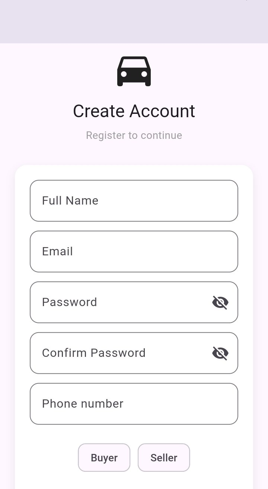
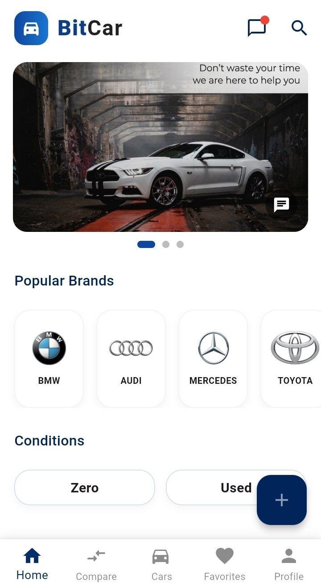
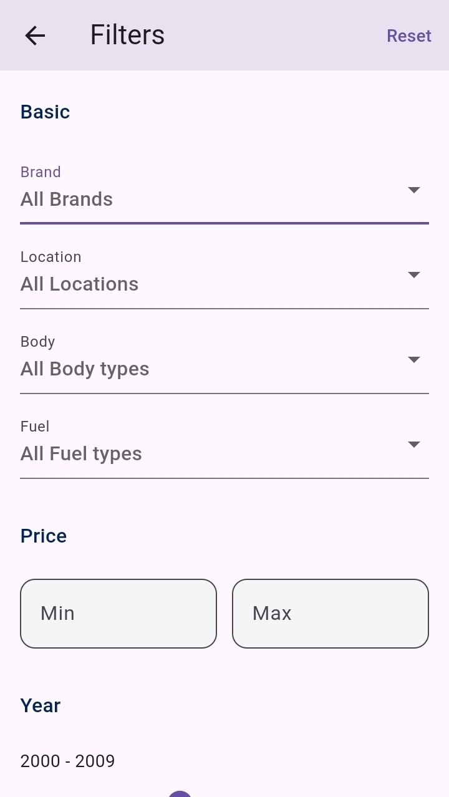
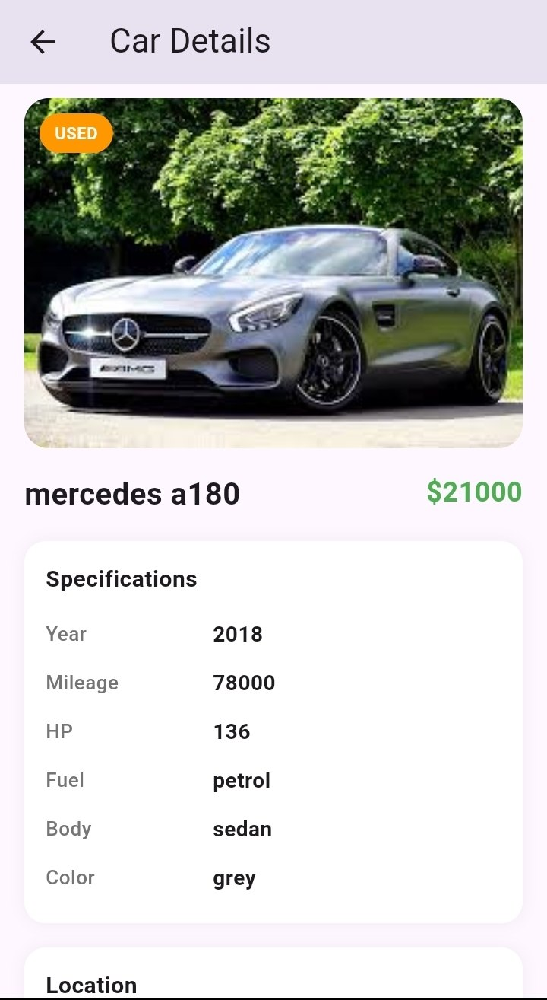
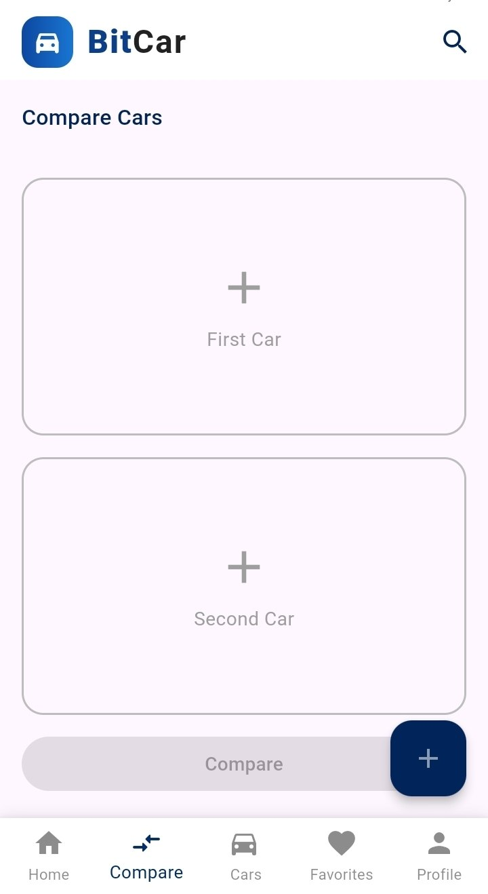
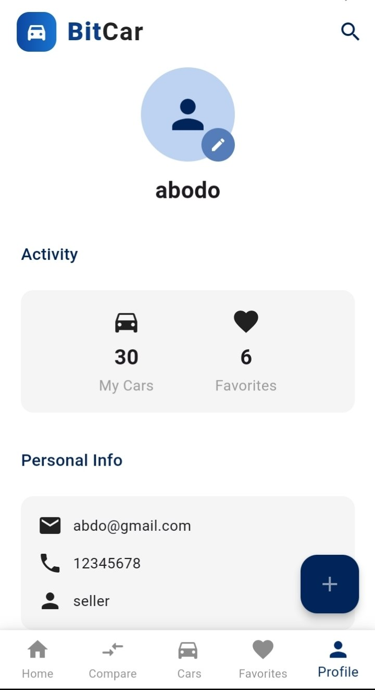

# BitCar — Flutter Car Marketplace

BitCar is a Flutter mobile application for browsing, listing, searching, and comparing new and used cars. I built this project independently from scratch to apply Flutter development practices and software architecture concepts in a practical application.

The application follows Clean Architecture and uses BLoC/Cubit for state management, with Firebase Authentication and Cloud Firestore for authentication, data management, and real-time buyer–seller communication. It provides role-based functionality for buyers, sellers, and administrators.

---

## Features

### Car Marketplace

* **Authentication:** User registration and login using Firebase Authentication.
* **Car Listings:** Browse new and used cars.
* **Advanced Search and Filtering:** Search for cars and filter listings using available car attributes.
* **Car Comparison:** Compare vehicle details to help users evaluate different options.
* **Listing Management:** Add, edit, and delete car listings.
* **Favorites:** Save and manage favorite cars.
* **Role-Based Functionality:** Separate functionality for Admin, Seller, and Buyer roles.
* **Banner Advertisement Management:** Allow administrators to manage banner advertisements.
* **Pagination and Lazy Loading:** Load car listings incrementally.

### Buyer–Seller Messaging

* **Real-Time Messaging:** Allow buyers and sellers to communicate directly through the application.
* **Unique Conversations:** Maintain one conversation per buyer–seller pair, allowing buyers to discuss different cars from the same seller within a single conversation.
* **Conversation List:** Display conversations with last-message previews and unread message counts.
* **Read Status:** Update message read statuses in real time.
* **Message Pagination:** Load older messages incrementally.
* **Connection Handling:** Handle connection states and support retry operations after interruptions.
* **Secure Conversation Management:** Support controlled deletion of messages and conversations.
* **Access Control:** Protect conversations and messages using Firestore Security Rules to prevent unauthorized access.
* **Session Isolation:** Prevent previous users' chat data from leaking across logout and account-switching operations.

### General

* **Responsive UI:** Reusable interface components designed for different screen sizes.
* **Error Handling:** Provide user-friendly feedback for application errors.

---

## Screenshots

| Register                                     | Home                                 |
| -------------------------------------------- | ------------------------------------ |
|  |  |

| Filter                                   | Car Details                                        |
| ---------------------------------------- | -------------------------------------------------- |
|  |  |

| Compare                                    | My Cars                                    |
| ------------------------------------------ | ------------------------------------------ |
|  |  |

| Conversations                                          | Chat Room                                      |
| ------------------------------------------------------ | ---------------------------------------------- |
|  |  |

| Profile                                    |
| ------------------------------------------ |
|  |

---

## Tech Stack

### Core Development

* Flutter
* Dart

### State Management

* BLoC
* Cubit

### Backend and Data

* Firebase Authentication
* Cloud Firestore
* Firestore Security Rules
* SharedPreferences

### Architecture and Design Patterns

* Clean Architecture
* Repository Pattern
* Dependency Injection with GetIt

### Development Tools

* Git
* GitHub

---

## Architecture

BitCar follows Clean Architecture to separate presentation, business logic, and data access concerns.

The application is organized around three main layers:

```text
Presentation
  ├── UI (Screens and Widgets)
  └── BLoC / Cubit
          │
          │ uses
          ▼
Domain
  ├── Entities / Domain Models
  ├── Use Cases
  └── Repository Contracts
          ▲
          │ implemented by
          │
Data
  ├── Data Models
  ├── Data Sources
  └── Repository Implementations
          │
          ▼
Firebase
  ├── Authentication
  └── Cloud Firestore
```

The Domain layer defines application logic and repository contracts. The Data layer provides repository implementations and handles data access, while the Presentation layer uses BLoC/Cubit to manage state and coordinate the user interface with application logic.

Within the car and chat modules, the Data and Domain layers are shared across their related features, while each feature maintains its own BLoC and UI components.

The chat module uses Firebase Authentication to identify conversation participants and Cloud Firestore for real-time message synchronization, conversation management, and read-status updates. Firestore Security Rules enforce access control over conversations and messages.

---

## Getting Started

### Prerequisites

* Flutter SDK
* Dart SDK
* A configured Firebase project

### Installation

Clone the repository:

```bash
git clone https://github.com/abdobittar99/bitcar-app.git
```

Navigate to the project directory:

```bash
cd bitcar-app
```

Install the dependencies:

```bash
flutter pub get
```

Configure Firebase for your target platform, then run the application:

```bash
flutter run
```

---

## Project Structure

```text
lib/
├── core/
├── entities/
├── features/
│   ├── auth/
│   │   ├── data/
│   │   │   ├── datasource/
│   │   │   └── repositories/
│   │   ├── domain/
│   │   │   ├── repositories/
│   │   │   └── usecase/
│   │   ├── login/
│   │   │   ├── bloc/
│   │   │   └── ui/
│   │   └── register/
│   │
│   ├── car/
│   │   ├── data/
│   │   ├── domain/
│   │   ├── cars_list/
│   │   │   ├── bloc/
│   │   │   └── ui/
│   │   ├── car_details/
│   │   │   ├── bloc/
│   │   │   └── ui/
│   │   ├── my_cars/
│   │   │   ├── bloc/
│   │   │   └── ui/
│   │   └── car_form/
│   │       ├── bloc/
│   │       └── ui/
│   │
│   ├── chat/
│   │   ├── chat_room/
│   │   │   ├── bloc/
│   │   │   └── ui/
│   │   ├── conversations/
│   │   │   ├── bloc/
│   │   │   └── ui/
│   │   ├── data/
│   │   │   ├── datasource/
│   │   │   └── repositories/
│   │   └── domain/
│   │       ├── model/
│   │       ├── repositories/
│   │       └── usecase/
│   │
│   └── compare/
│
├── models/
├── shared/
│   ├── components/
│   └── styles/
├── app_root.dart
└── main.dart
```

The project is organized into feature modules, shared components, and common application functionality.

Within the car and chat modules, the Data and Domain layers are shared across related features. Each feature maintains its own BLoC and UI components, reducing unnecessary duplication while keeping presentation logic organized.

---

## Image Handling

Vehicle images currently use local assets.

The image-source structure is prepared to support switching to Firebase Storage in the future. The `firebase_storage` package is included in the project dependencies, but Firebase Storage integration is not currently active, and vehicle images are not uploaded to Firebase Storage.

---

## Author

**Abdalrahman Bittar**

GitHub: [abdobittar99](https://github.com/abdobittar99)
