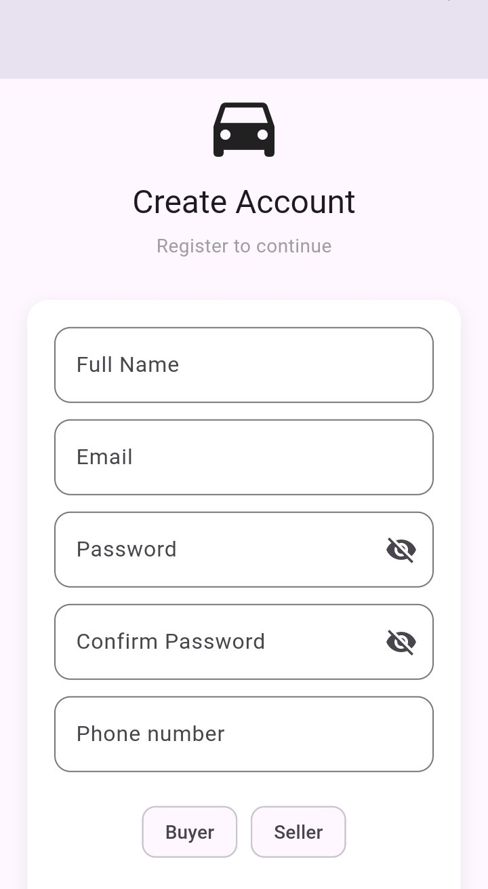
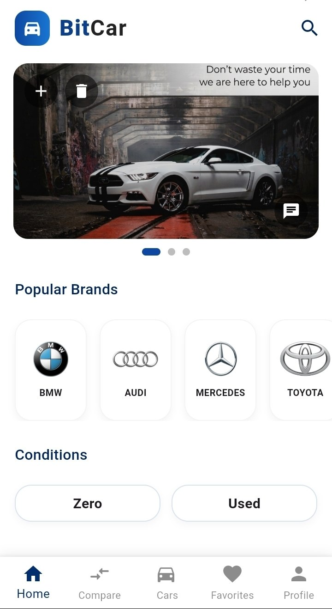
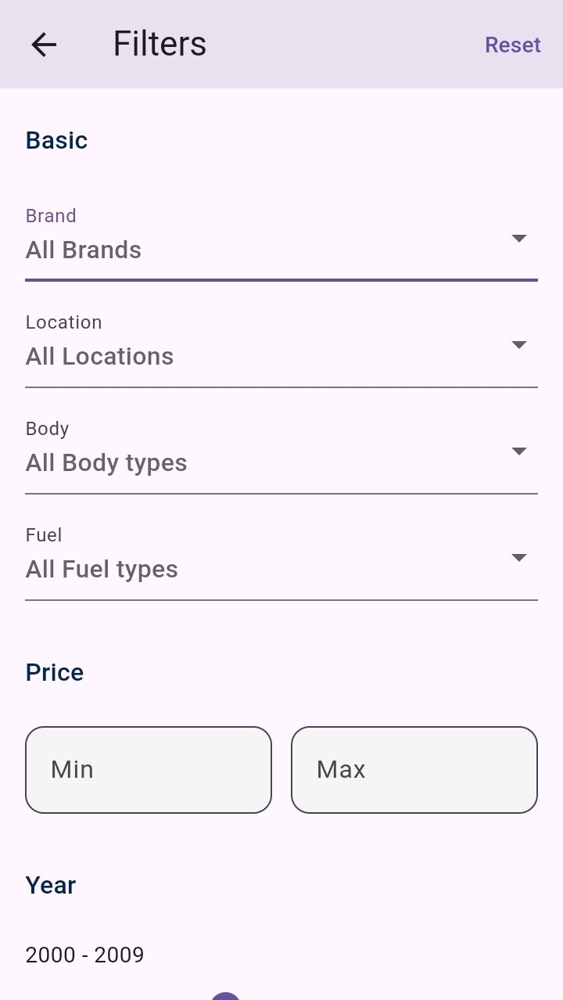
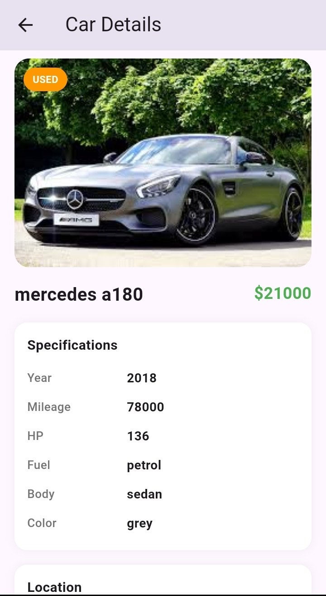
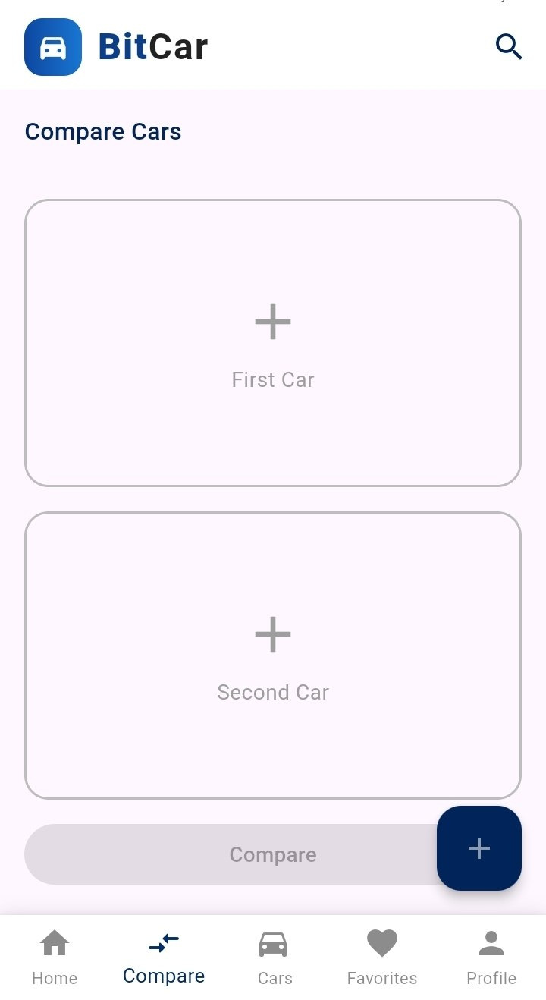
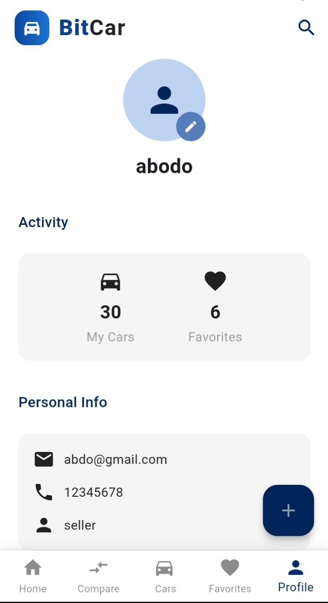

# BitCar — Flutter Car Marketplace

BitCar is a Flutter mobile application for browsing, listing, searching, and comparing new and used cars. I built this project independently from scratch to apply Flutter development practices and software architecture concepts in a practical application.

The application follows Clean Architecture and uses BLoC/Cubit for state management, with Firebase Authentication and Cloud Firestore for authentication and data management. It provides role-based functionality for buyers, sellers, and administrators.

---

## Features

* **Authentication:** User registration and login using Firebase Authentication.
* **Car Listings:** Browse new and used cars.
* **Advanced Search and Filtering:** Search for cars and filter listings using available car attributes.
* **Car Comparison:** Compare vehicle details to help users evaluate different options.
* **Listing Management:** Add, edit, and delete car listings.
* **Favorites:** Save and manage favorite cars.
* **Role-Based Functionality:** Separate functionality for Admin, Seller, and Buyer roles.
* **Banner Advertisement Management:** Allow administrators to manage banner advertisements.
* **Pagination and Lazy Loading:** Load car listings incrementally.
* **Responsive UI:** Reusable interface components designed for different screen sizes.
* **Error Handling:** Provide user-friendly feedback for application errors.

---

## Screenshots

| Register                                     | Home                                 |
| -------------------------------------------- | ------------------------------------ |
|  |  |

| Filter                                   | Car Details                                        |
| ---------------------------------------- | -------------------------------------------------- |
|  |  |

| Compare                                    | My Cars                                    |
| ------------------------------------------ | ------------------------------------------ |
|  |  |

| Profile                                    |
| ------------------------------------------ |
|  |

---

## Tech Stack

### Core Development

* Flutter
* Dart

### State Management

* BLoC
* Cubit

### Backend and Data

* Firebase Authentication
* Cloud Firestore
* SharedPreferences

### Architecture and Design Patterns

* Clean Architecture
* Repository Pattern
* Dependency Injection with GetIt

### Development Tools

* Git
* GitHub

---

## Architecture

BitCar follows Clean Architecture to separate presentation, business logic, and data access concerns.

The application is organized around three main layers:

```text
Presentation
  ├── UI (Screens and Widgets)
  └── BLoC / Cubit
          │
          │ uses
          ▼
Domain
  ├── Entities
  ├── Use Cases
  └── Repository Contracts
          ▲
          │ implemented by
          │
Data
  ├── Models
  ├── Data Sources
  └── Repository Implementations
          │
          ▼
Firebase
  ├── Authentication
  └── Cloud Firestore
```

The Domain layer defines application logic and repository contracts. The Data layer provides repository implementations and handles data access, while the Presentation layer uses BLoC/Cubit to manage state and coordinate the user interface with application logic.

---

## Getting Started

### Prerequisites

* Flutter SDK
* Dart SDK
* A configured Firebase project

### Installation

Clone the repository:

```bash
git clone https://github.com/abdobittar99/bitcar-app.git
```

Navigate to the project directory:

```bash
cd bitcar-app
```

Install the dependencies:

```bash
flutter pub get
```

Configure Firebase for your target platform, then run the application:

```bash
flutter run
```

---

## Project Structure

```text
lib/
├── core/
├── entities/
├── models/
├── modules/
│   ├── auth/
│   │   ├── data/
│   │   │   ├── datasource/
│   │   │   └── repositories/
│   │   ├── domain/
│   │   │   ├── repositories/
│   │   │   └── usecase/
│   │   ├── login/
│   │   │   ├── bloc/
│   │   │   └── ui/
│   │   └── register/
│   │
│   ├── car/
│   │   ├── data/
│   │   ├── domain/
│   │   ├── car_list/
│   │   │   ├── bloc/
│   │   │   └── ui/
│   │   ├── car_details/
│   │   │   ├── bloc/
│   │   │   └── ui/
│   │   ├── my_cars/
│   │   │   ├── bloc/
│   │   │   └── ui/
│   │   └── car_form/
│   │       ├── bloc/
│   │       └── ui/
│   │
│   └── ... other application modules
│
├── shared/
│   ├── components/
│   └── styles/
├── services/
└── main.dart
```

The project is organized into feature modules, shared components, and common application services.

Within the car module, the `data` and `domain` layers are shared across the car-related features, while each feature maintains its own BLoC and UI components.


---

## Image Handling

Vehicle images currently use local assets.

The image-source structure is prepared to support switching to Firebase Storage in the future. However, Firebase Storage integration is not currently active, and the application does not currently upload vehicle images to Firebase Storage.

---

## Author

**Abdalrahman Bittar**

GitHub: [abdobittar99](https://github.com/abdobittar99)
